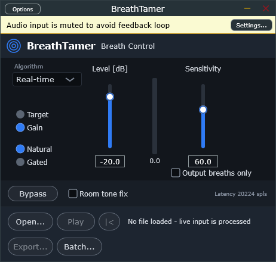
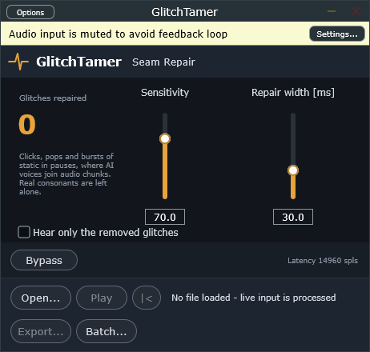

# Narration Tools: tame AI voice glitches

**Free, open-source plugins that tame the glitches AI text-to-speech leaves in
narration.** Built for AI-voiced audiobooks, podcasts and voice-over, and they
work on human recordings too.

AI TTS engines generate speech in chunks and stitch them together. The seams can
leave **clicks, pops and bursts of static** in the pauses, and many AI voices add
**breaths that are too loud or too frequent**. Fixing them by hand means hunting
through every chapter. These tools do it automatically and leave real speech
alone:

- **GlitchTamer** removes seam clicks, pops and static bursts, filling them with
  the recording's own room tone. Real "t", "k", "p" and "g" sounds are not touched.
- **BreathTamer** turns breaths down or removes them, keeping the room tone
  underneath so there are no dead-air holes.

Each tool comes as a **VST3 plugin** (REAPER and other DAWs), a **standalone app**
(open, play, export, batch) and a **command-line tool** for batch processing
whole books. Windows, 64-bit.

| | |
|---|---|
|  |  |

## BreathTamer: breath control

Detects breaths by their sound (unvoiced, breathy noise between phrases), not by
level, and turns them down or removes them. Real consonants and word endings are
protected.

| Control | What it does |
|---|---|
| **Algorithm** | *Real-time* analyses as it plays. *Offline* first analyses the whole file (standalone Export/Batch and the CLI). *Classic* is the 1.0 detector, gated only. |
| **Target / Gain** | *Gain* cuts every breath by the Level amount. *Target* only pulls breaths louder than the Level down to it, so quiet natural breaths stay. |
| **Level** | -inf to 0 dB. |
| **Natural / Gated** | *Natural* keeps the room tone under removed breaths (no dead-air holes). *Gated* cuts everything. |
| **Room tone fix** | Natural only, off by default. Learns room tone only from audio well below speech; affects the first breath after playback starts mid-speech. |
| **Sensitivity** | Higher catches shorter, louder, brighter breaths. |
| **Output breaths only** | Hear only what is detected. |
| **Bypass** | Latency-compensated A/B. |

## GlitchTamer: seam repair

AI voice engines join generated audio chunks, and the joins ("seams") can leave
**clicks/pops** and short **bursts of static** in the pauses. GlitchTamer repairs
both with the recording's own room tone.

Consonants ("t", "k", "p", and word-final "g") are sharp too, so an event is
repaired only when it is cut off from speech on both sides: nothing spoken right
after it, and either no speech in the 150 ms before it or at least 30 ms of exact
digital silence in between, which is where AI voices join their chunks. Work on
the original TTS output (WAV) where possible: those silent gaps are the clearest
sign of a seam.

| Control | What it does |
|---|---|
| **Sensitivity** | Higher catches fainter clicks and bursts. |
| **Repair width** | Longest span repaired after a click (its ringing tail). |
| **Hear only the removed glitches** | Audition what is removed; a warning shows while on. |
| **Bypass** | Latency-compensated A/B. |

Tip: when auditioning with a loop, include the pause after the glitch. A loop
that jumps straight back into speech makes a click look like a consonant.

## Recommended use

- Put **GlitchTamer before BreathTamer** in the chain.
- Work in **WAV** (24-bit or float) and encode MP3/M4B once at the end; MP3 smears
  the clicks and breath detail these tools rely on.
- Audio outside a repair is passed through unchanged, sample for sample.

## Download and install

Get the latest zip from [Releases](../../releases). Copy the `.vst3` folders to
`C:\Program Files\Common Files\VST3` (or `%LOCALAPPDATA%\Programs\Common\VST3`)
and re-scan plug-ins in your DAW. The apps and CLI tools run as-is. The builds are
not code-signed, so Windows SmartScreen may warn on first launch.

## Command line

```
breathtamer-cli in.wav out.wav [--mode gain|target] [--level dB] [--sens 0-100]
                [--algorithm offline|realtime|classic] [--gated] [--strict-room-tone]
                [--breaths-only] [--regions breaths.csv]
glitchtamer-cli in.wav out.wav [--sens 0-100] [--width ms] [--glitches-only] [--report glitches.csv]
```

WAV in, 24-bit WAV out, sample-aligned with the input.

## Building from source

Requires CMake 3.22+ and Visual Studio 2022 (Desktop C++). JUCE 8 is downloaded
automatically.

```
cmake -S . -B build -G "Visual Studio 17 2022" -A x64
cmake --build build --config Release
```

Keep the source and build paths short (MSBuild struggles with deep paths). The
DSP engines (`*/Source/*Engine.h`) are plain C++17 with no framework dependency.

## License

[GNU AGPLv3](LICENSE). Built with [JUCE](https://juce.com) under its AGPLv3 option.

Not affiliated with or endorsed by iZotope or Native Instruments. "iZotope" and
"RX" are trademarks of their owners. BreathTamer's controls follow the documented
behaviour of RX Breath Control; all code here is original, and no iZotope code or
trained models are used.
