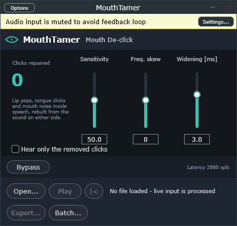
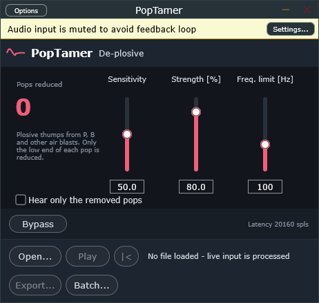
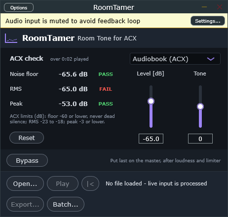

# Narration Tools: tame AI voice glitches

**Free, open-source plugins that tame the glitches AI text-to-speech leaves in
narration.** Built for AI-voiced audiobooks, podcasts and voice-over, and they
work on human recordings too.

AI TTS engines generate speech in chunks and stitch them together. The seams can
leave **clicks, pops and bursts of static** in the pauses. Many AI voices also
add **breaths that are too loud or too frequent**, **mouth clicks and lip
smacks**, and **plosive thumps** on "p" and "b", and their pauses are **dead
digital silence**, which audiobook platforms such as ACX reject. Fixing all that
by hand means hunting through every chapter. These tools do it automatically and
leave real speech alone:

- **GlitchTamer** removes seam clicks, pops and static bursts, filling them with
  the recording's own room tone. Real "t", "k", "p" and "g" sounds are not touched.
- **MouthTamer** removes lip smacks, tongue clicks and mouth crackle inside
  speech, rebuilding each click from the sound on either side.
- **PopTamer** turns down the low thump of "p", "b" and other air blasts, only in
  the low end and only during the pop.
- **BreathTamer** turns breaths down or removes them, keeping the room tone
  underneath so there are no dead-air holes.
- **RoomTamer** lays one steady room tone under the finished book so pauses are
  never dead silence, at a level ACX accepts, and meters the noise floor, RMS and
  peak against ACX's limits.

Each tool comes as a **VST3 plugin** (REAPER and other DAWs), a **standalone app**
(open, play, export, batch) and a **command-line tool** for batch processing
whole books. Windows, 64-bit.

| | | |
|---|---|---|
|  |  |  |
|  |  | |

## BreathTamer: breath control

Detects breaths by their sound (unvoiced, breathy noise between phrases), not by
level, and turns them down or removes them. Real consonants and word endings are
protected.

| Control | What it does |
|---|---|
| **Algorithm** | *Real-time* analyses as it plays. *Offline* first analyses the whole file (standalone Export/Batch and the CLI). *Classic* is the 1.0 detector, gated only. |
| **Target / Gain** | *Gain* cuts every breath by the Level amount. *Target* only pulls breaths louder than the Level down to it, so quiet natural breaths stay. |
| **Level** | -inf to 0 dB. |
| **Natural / Gated** | *Natural* keeps the room tone under removed breaths (no dead-air holes). *Gated* cuts everything. |
| **Room tone fix** | Natural only, off by default. Learns room tone only from audio well below speech; affects the first breath after playback starts mid-speech. |
| **Sensitivity** | Higher catches shorter, louder, brighter breaths. |
| **Output breaths only** | Hear only what is detected. |
| **Bypass** | Latency-compensated A/B. |

## GlitchTamer: seam repair

AI voice engines join generated audio chunks, and the joins ("seams") can leave
**clicks/pops** and short **bursts of static** in the pauses. GlitchTamer repairs
both with the recording's own room tone.

Consonants ("t", "k", "p", and word-final "g") are sharp too, so an event is
repaired only when it is cut off from speech on both sides: nothing spoken right
after it, and either no speech in the 150 ms before it or at least 30 ms of exact
digital silence in between, which is where AI voices join their chunks. Work on
the original TTS output (WAV) where possible: those silent gaps are the clearest
sign of a seam.

| Control | What it does |
|---|---|
| **Sensitivity** | Higher catches fainter clicks and bursts. |
| **Repair width** | Longest span repaired after a click (its ringing tail). |
| **Hear only the removed glitches** | Audition what is removed; a warning shows while on. |
| **Bypass** | Latency-compensated A/B. |

Tip: when auditioning with a loop, include the pause after the glitch. A loop
that jumps straight back into speech makes a click look like a consonant.

## MouthTamer: mouth de-click

Some AI voices sound great but crackle with lip smacks and tongue clicks. A click
is unpredictable where speech is not, so MouthTamer finds it as a spike in the
voice's short-term prediction error, then rebuilds that stretch from 20 ms of
audio on either side. Spikes longer than about 4 ms (consonants), plosive
releases and the starts of AI chunks are left alone.

| Control | What it does |
|---|---|
| **Sensitivity** | How many clicks are detected. High values can start to touch plosives. |
| **Frequency skew** | Detection band: negative for generic low clicks, 0 and above for mouth clicks. |
| **Click widening [ms]** | Extends each repair to cover the decay of lip smacks (default 3). |
| **Hear only the removed clicks** | Audition what is removed; a warning shows while on. |
| **Bypass** | Latency-compensated A/B. |

## PopTamer: de-plosive

A plosive pop is a short burst of low-frequency energy, well above what the
voice itself puts in that range. PopTamer compares the 20-80 Hz band with what
the voice explains there at that moment, so pops at the start of words are found
while normal low vowels are not. Only the band below the frequency limit is
turned down, and only for the pop's span, through a linear-phase filter.

| Control | What it does |
|---|---|
| **Sensitivity** | How many pops are detected. |
| **Strength [%]** | How much of each pop is removed; 100% brings it down to the voice's own low end. |
| **Frequency limit [Hz]** | Highest frequency reduced (default 100, which keeps the voice's low notes intact). |
| **Hear only the removed pops** | Audition what is removed; a warning shows while on. |
| **Bypass** | Latency-compensated A/B. |

## RoomTamer: room tone for ACX

AI voices pause in exact digital silence. ACX rejects dead silence and requires a
noise floor of -60 dB RMS or lower, with room tone at the head (0.5-1 s) and tail
(1-5 s) of each file. RoomTamer adds one steady, natural room tone (pink-shaped,
with a soft low-end lift and a gentle top roll-off, identical in every channel)
at an exact level, and shows ACX's checks as you play.

| Control | What it does |
|---|---|
| **Preset** | *Audiobook (ACX)* at -65 dB or *extra quiet* at -70 dB. Also in the DAW's preset menu. |
| **Level [dB]** | Room tone level, measured the way ACX measures the noise floor. |
| **Tone** | Darker or brighter room. |
| **ACX check** | Noise floor (quietest 500 ms), RMS (-23 to -18 dB) and peak (-3 dB or lower), each PASS/FAIL, since playback started. Dead silence fails. **Reset** starts a new reading. |
| **Bypass** | Dry signal, for A/B; the meter keeps measuring. |

Put RoomTamer **last on the master track, after any loudness or limiter
plugin**: anything that raises the level afterwards raises the room tone too.
Leave the head and tail space in your render range and it fills them with room
tone. The room tone follows the timeline, so every render of the same range is
identical. (The screenshot shows room tone alone, so its RMS check fails until a
voice plays.)

## Recommended use

- Repair chain on each voice track: **GlitchTamer, MouthTamer, PopTamer, then
  BreathTamer**.
- Then set loudness, and put **RoomTamer last** on the master.
- Work in **WAV** (24-bit or float) and encode MP3/M4B once at the end; MP3 smears
  the clicks and breath detail these tools rely on.
- The repair tools pass audio outside a repair through unchanged, sample for
  sample.

## Download and install

Get the latest zip from [Releases](../../releases). Copy the `.vst3` folders to
`C:\Program Files\Common Files\VST3` (or `%LOCALAPPDATA%\Programs\Common\VST3`)
and re-scan plug-ins in your DAW. The apps and CLI tools run as-is. The builds are
not code-signed, so Windows SmartScreen may warn on first launch.

## Command line

```
breathtamer-cli in.wav out.wav [--mode gain|target] [--level dB] [--sens 0-100]
                [--algorithm offline|realtime|classic] [--gated] [--strict-room-tone]
                [--breaths-only] [--regions breaths.csv]
glitchtamer-cli in.wav out.wav [--sens 0-100] [--width ms] [--glitches-only] [--report glitches.csv]
mouthtamer-cli  in.wav out.wav [--sens 0-100] [--skew -100..100] [--widening ms] [--clicks-only] [--report clicks.csv]
poptamer-cli    in.wav out.wav [--sens 0-100] [--strength 0-100] [--limit Hz] [--pops-only] [--report pops.csv]
roomtamer-cli   in.wav out.wav [--level dB] [--tone -100..100] [--bypass]
```

WAV in, 24-bit WAV out, sample-aligned with the input. `roomtamer-cli` prints the
ACX check of its output; with `--bypass` it only checks the file.

## Building from source

Requires CMake 3.22+ and Visual Studio 2022 (Desktop C++). JUCE 8 is downloaded
automatically.

```
cmake -S . -B build -G "Visual Studio 17 2022" -A x64
cmake --build build --config Release
```

Keep the source and build paths short (MSBuild struggles with deep paths). The
DSP engines (`*/Source/*Engine.h`) are plain C++17 with no framework dependency.

## License

[GNU AGPLv3](LICENSE). Built with [JUCE](https://juce.com) under its AGPLv3 option.

Not affiliated with or endorsed by iZotope, Native Instruments, ACX or Audible.
"iZotope", "RX", "ACX" and "Audible" are trademarks of their owners. The
controls of BreathTamer, MouthTamer and PopTamer follow the documented behaviour
of RX Breath Control, Mouth De-click and De-plosive; all code here is original,
and no iZotope code or trained models are used.
